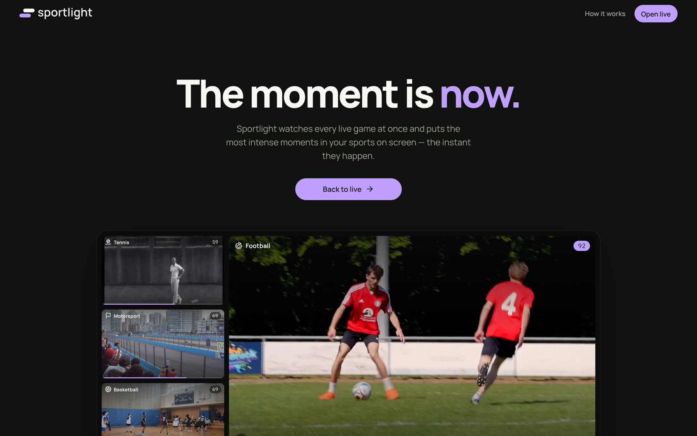
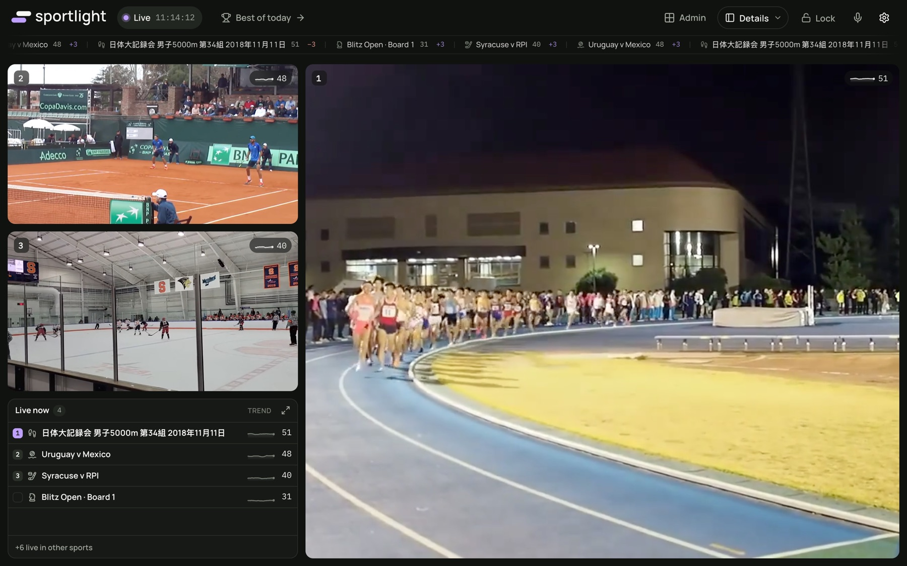
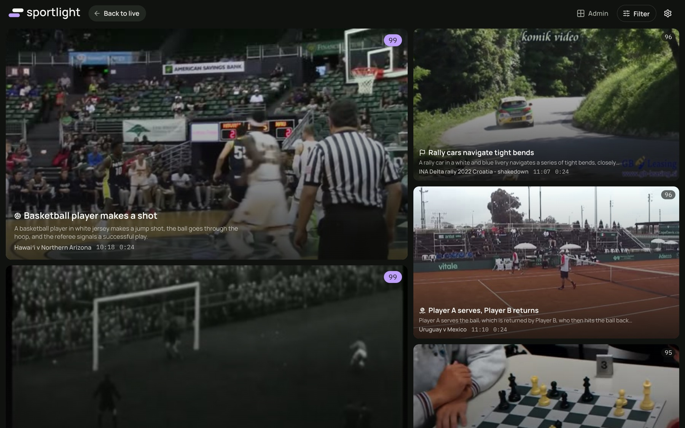
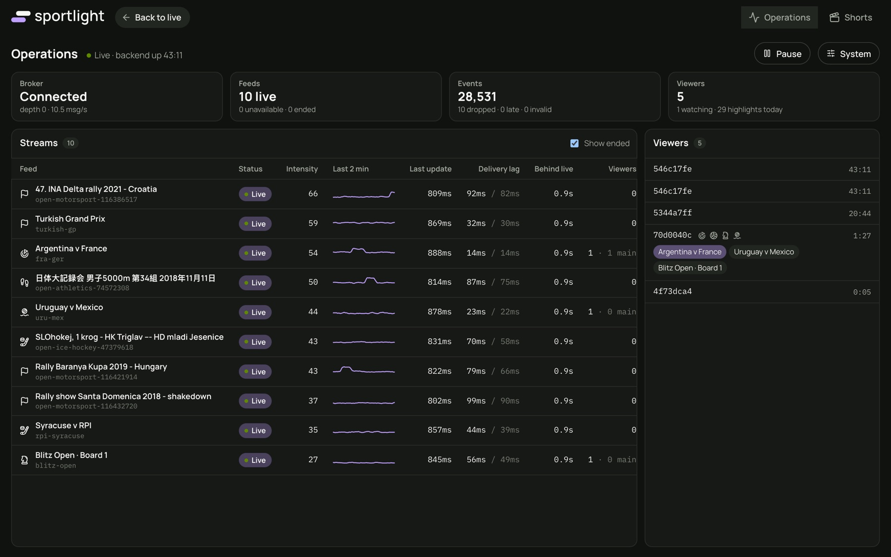
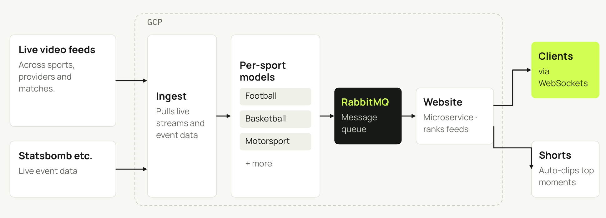

<p align="center">
  <picture>
    <source media="(prefers-color-scheme: dark)" srcset="logos/sportlight-reversed.svg">
    
  </picture>
</p>

<h3 align="center">The moment is now.</h3>

<p align="center">
  Sportlight watches every live game at once and puts the most intense moments in your sports on screen, the instant they happen.
</p>

<p align="center">
  Powered by <a href="https://github.com/Asyncharles/SportlightEngine"><b>SportlightEngine</b></a>, the real-time intensity scorer.
</p>

<p align="center">
  
</p>

---

## Always on the best game

One main window, side windows and a live table ranked by intensity. When something big starts happening elsewhere, Sportlight brings it to you with a smooth on-screen switch.

<p align="center">
  
</p>

## Best of Today

Big moments are clipped automatically and captioned by AI, ranked by how intense they were.

<p align="center">
  
</p>

## Straight to Shorts

Every qualifying highlight is rendered as a vertical Short with burned-in commentary captions, ready to review and publish to YouTube in one click.

## Built for live

Feed state, intensity and viewers are visible in real time, and the pipeline absorbs duplicates, late readings and dropped feeds without missing a beat.

<p align="center">
  
</p>

## How it works

<p align="center">
  
</p>

1. **[SportlightEngine](https://github.com/Asyncharles/SportlightEngine)** scores every feed's intensity in real time.
2. The **backend** keeps live state, detects highlight moments and streams updates to every viewer.
3. The **web app** picks what to show per viewer, based on intensity, their sports and their votes.

TypeScript throughout: Node backend, React + Vite client, RabbitMQ, FFmpeg, Gemini and whisper.cpp.

## Run it

```bash
docker compose up --build
```

Then open **http://localhost:8080**. The first build downloads openly licensed demo footage from Wikimedia Commons.

For local development, configuration, the engine demo feeds, YouTube setup and deployment, see the **[development guide](docs/development.md)**.

## Learn more

- [Development guide](docs/development.md): setup, architecture, configuration and tests
- [Deployment](docs/deployment.md)
- [Product spec](docs/specs/product-spec.md)
